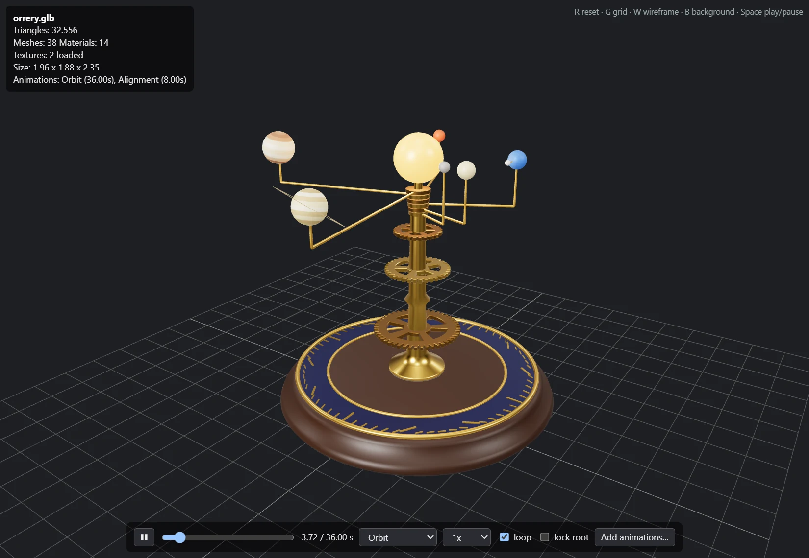
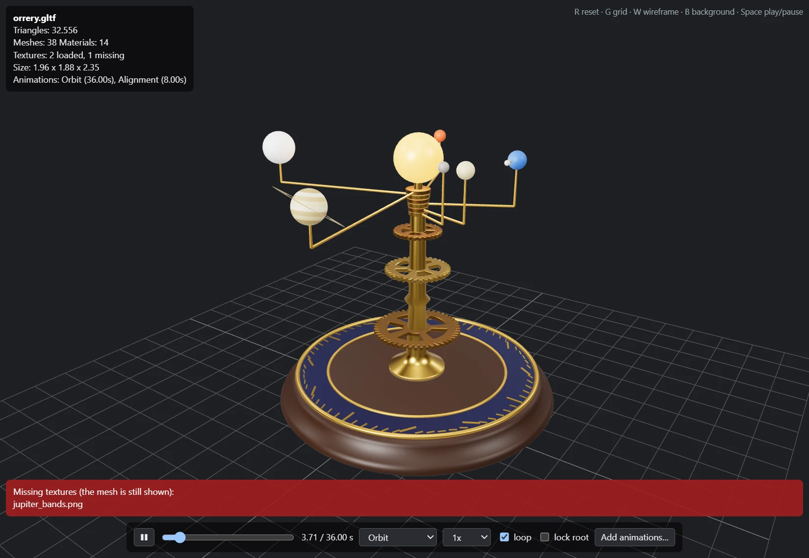
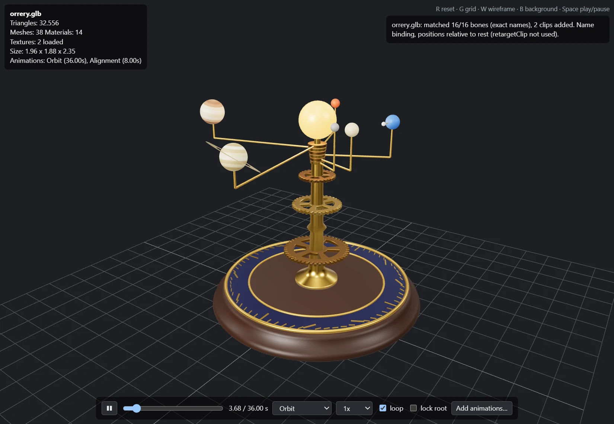

<p align="center"></p>

<h1 align="center">Orrery</h1>

<p align="center">
  <b>Double-click a model. Look at it.</b><br>
  A fast, tiny 3D model viewer for FBX, glTF and GLB on Windows:<br>
  one 3.6 MB exe, no installer, and no network access at all.
</p>

<p align="center">
  <a href="https://orrery.renner.dev">Website</a> ·
  <a href="https://github.com/rennerdo30/orrery/releases/latest">Download</a> ·
  <a href="https://github.com/rennerdo30/orrery/issues">Issues</a> ·
  <a href="CHANGELOG.md">Changelog</a> ·
  <a href="LICENSE">MIT license</a>
</p>

<p align="center">
  
</p>

## Why Orrery

Looking at a 3D asset should not mean starting a DCC tool or a game engine. Orrery opens the file the moment you double-click it: **framed, lit, measured and already playing its first animation**. The overlay answers the questions you have about a model you just downloaded or exported (how heavy is it, did its textures come along, what units is it in, which clips does it carry), and a banner says clearly what went wrong when something did, while the mesh is still shown.

It treats every model as a file from a stranger: the viewer reads only the model and the images and buffers it needs, and it **cannot reach the network**.

## Features

| | |
|---|---|
| **Opens and frames** | Opens the file passed as the first argument; drag and drop another file onto the window to switch. Auto-framing, orbit / pan / zoom, studio lighting with an environment map. Dark window from the first frame and a loading screen (icon, file name, status). |
| **Info overlay** | Triangles, meshes, materials, textures (loaded and missing), bounding-box size and animation clips. |
| **Animation playback** | Plays the first clip at once. Play/pause (Space), timeline scrubber, speed 0.25x to 2x, loop, clip list and *lock root*, which keeps the root bone in place. |
| **Borrow clips** | *Add animations...* or Shift+drop another FBX/GLB to bind its clips to the loaded model by bone name: exact first, then normalised (case, spaces, underscores, `mixamorig:`, `Armature\|` ignored). Missing bones are dropped and a summary such as *matched 52/65 bones* is shown, with a warning when few match. Position tracks are rescaled by the median bone-length ratio (FBX cm vs m) and applied relative to the rest pose. This is name binding, not a full retarget. |
| **Finds textures** | Embedded (GLB, FBX), paths relative to the model (including backslashes and `..`), the exact absolute path written in an FBX, TGA, and a fallback search by file name (or the same name with another image extension) in the model's folder tree and its parent's. Missing ones are listed. |
| **Safe by design** | Read-only access to the open model, its images and glTF `.bin` buffers; every remote URL blocked; strict Content-Security-Policy. See [Security](#security). |
| **Lives in Explorer** | `register.ps1` adds Orrery to *Open with* for `.fbx`, `.glb` and `.gltf`, per user, no admin rights. |

| Key | Action |
|-----|--------|
| <kbd>R</kbd> | Reset view |
| <kbd>G</kbd> | Toggle grid |
| <kbd>W</kbd> | Toggle wireframe |
| <kbd>B</kbd> | Dark / light background |
| <kbd>Space</kbd> | Play / pause |

<table>
  <tr>
    <td></td>
    <td></td>
  </tr>
  <tr>
    <td align="center"><b>Missing textures</b> are named in a banner; the mesh is still drawn.</td>
    <td align="center"><b>Add animations</b> binds clips from another file by bone name and says how many matched.</td>
  </tr>
</table>

<sub>Real captures of `orrery.exe` with an original model; see [docs/SCREENSHOTS.md](docs/SCREENSHOTS.md).</sub>

## Get started

1. Download `orrery-<version>-windows-x64.zip` from the [latest release](https://github.com/rennerdo30/orrery/releases/latest) (about 1.2 MB) and unzip it to a folder you will keep; the file association stores the exe's path.
2. Optional: run `register.ps1` (right-click, *Run with PowerShell*, or `powershell -ExecutionPolicy Bypass -File register.ps1`) to add Orrery to the *Open with* list for `.fbx`, `.glb` and `.gltf`.
3. Make it the default once: right-click a model file, *Open with*, *Choose another app*, Orrery, *Always*.

The exe is not code-signed, so Windows SmartScreen may warn on the first run: choose *More info*, then *Run anyway*. The WebView2 runtime is required; it is preinstalled on Windows 10 and 11.

## How it works

```
 orrery.exe (Rust: tao window + wry WebView2, ~3.6 MB, three.js r186 embedded)
   ├─ /       the embedded viewer page (index.html, viewer.js, three.js), on app.localhost
   ├─ /m/     files next to the model: the model itself, images, .bin        ─┐  src/resolve.rs:
   ├─ /t/     texture paths written inside the model (absolute, ..), images ─┘  checked, read-only
   └─ IPC     title, log lines, screenshot data; navigation and new windows denied

 viewer.js (three.js)
   GLTFLoader / FBXLoader / TGALoader → framing, lighting, overlay, AnimationMixer
   remote URLs in a model → replaced and reported as "remote resource blocked: <url>"
```

## Security

Orrery only reads files, and only these: the model that is open, image files (png, jpg/jpeg, tga, bmp, webp, gif, ktx2) and glTF `.bin` buffers. Every served file must, after links and junctions are resolved, be inside the model's folder or its parent folder; the one exception is an image whose exact absolute path is written in the model file. Other file types, other model files, UNC paths and drive-relative paths are refused (unit tests in `src/resolve.rs`).

It never touches the network: the page has a strict Content-Security-Policy (`'self'`, `data:`, `blob:` only), every URL with a scheme other than `data:` or `blob:` (`http(s)`, `ftp`, `ws`, ...) found in a model is blocked and reported as "remote resource blocked: <url>", and navigation away from the app and new windows are denied.

## Build from source

Requires a Rust toolchain and the WebView2 runtime (present on Windows 11).

```
cargo build --release
```

The exe is `target/release/orrery.exe` (about 3.6 MB, three.js is embedded). Run the unit tests with `cargo test --release`. `scripts/package-release.ps1` builds the release zip with local paths stripped and prints its SHA-256.

Optional flags (used by `scripts/smoke-test.ps1`): `--log <file>` appends load results; `--screenshot <png>` saves the rendered view and exits; `--lib <file>` adds an animation library after loading; `--wait <ms>` delays the screenshot.

### Register as a handler (current user, no admin)

```
powershell -ExecutionPolicy Bypass -File register.ps1
powershell -ExecutionPolicy Bypass -File unregister.ps1
```

`register.ps1` uses `dist\orrery.exe` if it exists, otherwise `target\release\orrery.exe`; pass `-Exe <path>` to register another copy (copy the exe somewhere permanent first, the registry stores its path). It writes only under `HKCU\Software\Classes` (ProgID `Orrery.Model`, `Applications\orrery.exe`, and `OpenWithProgids` for `.fbx`, `.glb`, `.gltf`). Windows does not allow programs to set the default app silently, so choose it once as described above.

### Icon

`assets/icon.svg` (48 px and up) and `assets/icon-small.svg` (16 to 32 px) are rendered into `assets/orrery.ico` by `tools/make-icon`:

```
cargo run --release --manifest-path tools/make-icon/Cargo.toml -- .
```

### Website

`website/` is the static homepage at [orrery.renner.dev](https://orrery.renner.dev), deployed by the manual **Website Pages** workflow. See [website/README.md](website/README.md).

## Limitations

- FBX is read by three.js `FBXLoader`, which supports FBX 7.x; older versions (for example 6.1) fail with an error message.
- PSD textures cannot be decoded (a TGA/PNG with the same name is used if found). Missing-texture search covers only the model folder tree (5 levels) and its parent folder tree (4 levels); links and junctions are not followed.
- Parsing runs on the main thread: a very large FBX (for example a 40-clip library) can take several seconds; the loading screen is shown during the parse (its spinner is a CSS compositor animation, whether it keeps moving under a long parse was not verified) and the page is not interactive until the parse ends.
- Animation libraries need the same bone names; rigs with different names (for example Mixamo vs Unreal-style) do not match.
- No KTX2/Draco/Meshopt decoders are bundled; glTF files using those extensions will not load.
- Windows only.

## License

MIT, see `LICENSE`.

Orrery bundles three.js r186 and fflate (both MIT), links 101 Rust crates under permissive licences (MIT, Apache-2.0, Unicode-3.0, Zlib, BSD-style and similar) and statically links the Microsoft WebView2 SDK loader (BSD-style licence). Their licence texts and copyright notices are in [`THIRD_PARTY_NOTICES`](THIRD_PARTY_NOTICES), which ships in every release zip; regenerate it with `tools/gen-notices/gen-notices.ps1` after dependency updates. The website serves the same three.js files, with notices in [`website/vendor/LICENSES.txt`](website/vendor/LICENSES.txt).
