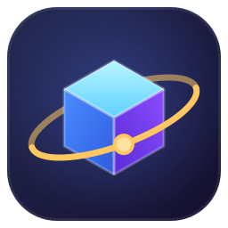

<p align="center"></p>

# Orrery

Orrery — a fast, tiny 3D model viewer for FBX, glTF and GLB.

Double-click a model, look at it. Works offline; no server, no installer.

<!-- screenshot: viewer with a character model -->
<!-- screenshot: animation dropdown and info overlay -->

## Features

- Opens the file passed as the first argument; drag and drop another file onto the window to switch
- Auto-framing, orbit / pan / zoom
- Studio lighting with an environment map
- Info overlay: triangles, meshes, materials, textures, bounding-box size, animation clips
- Plays the first animation, with a dropdown for the others
- Playback controls: play/pause (Space), timeline scrubber, speed 0.25x-2x, loop, clip dropdown, optional "lock root"
- Add animations from another FBX/GLB onto the loaded model ("Add animations..." button, or Shift+drop): clips are bound to the model's bones by exact name, then by normalised name (case, spaces/underscores, `mixamorig:`, `Armature|` prefixes ignored); tracks for bones the model lacks are dropped, a summary ("matched 52/65 bones") is shown, with a warning when few match. Position tracks are rescaled by the median bone-length ratio (FBX cm vs m) and applied relative to the model's rest pose. This is name binding, not a full retarget
- Textures: embedded (GLB, FBX), relative, absolute and backslash paths, TGA, and a fallback search by file name next to the model and in its parent folder; missing ones are listed in the overlay
- Loading screen (icon, file name, status) and a dark window from the first frame
- Clear error banner when something fails (for example missing FBX textures); the mesh is still shown

| Key | Action |
|-----|--------|
| R | Reset view |
| G | Toggle grid |
| W | Toggle wireframe |
| B | Dark / light background |

## Build

Requires a Rust toolchain and the WebView2 runtime (present on Windows 11).

```
cargo build --release
```

The exe is `target/release/orrery.exe` (about 3.5 MB, three.js is embedded).

Optional flags (used by `scripts/smoke-test.ps1`): `--log <file>` appends load results; `--screenshot <png>` saves the rendered view and exits; `--lib <file>` adds an animation library after loading; `--wait <ms>` delays the screenshot.

## Register as a handler (current user, no admin)

```
powershell -ExecutionPolicy Bypass -File register.ps1
powershell -ExecutionPolicy Bypass -File unregister.ps1
```

`register.ps1` writes only under `HKCU\Software\Classes` (ProgID `Orrery.Model`, `Applications\orrery.exe`, and `OpenWithProgids` for `.fbx`, `.glb`, `.gltf`). Windows does not allow programs to set the default app silently, so do this once: right-click a model file, Open with, Choose another app, Orrery, Always.

## Icon

`assets/icon.svg` (48 px and up) and `assets/icon-small.svg` (16 to 32 px) are rendered into `assets/orrery.ico` by `tools/make-icon`:

```
cargo run --release --manifest-path tools/make-icon/Cargo.toml -- . 
```

## Limitations

- FBX is read by three.js `FBXLoader`: binary FBX 7.x works best; ASCII FBX and very old versions may fail or lose data.
- Texture lookup is read-only and limited to image files; only the model's folder and its parent folder are searched for a missing texture name. PSD textures cannot be decoded (a TGA/PNG with the same name is used if found).
- Parsing runs on the main thread: a very large FBX (for example a 40-clip library) can take several seconds; the loading screen stays visible and its ring keeps spinning (compositor animation), but the page is not interactive until the parse ends.
- FBX files older than version 7000 (for example 6.1) are not supported by three.js.
- Animation libraries need the same bone names; rigs with different names (for example Mixamo vs Unreal-style) do not match.
- No KTX2/Draco/Meshopt decoders are bundled; glTF files using those extensions will not load.

## License

MIT, see `LICENSE`. three.js (MIT) is bundled, see `THIRD_PARTY_NOTICES`.
